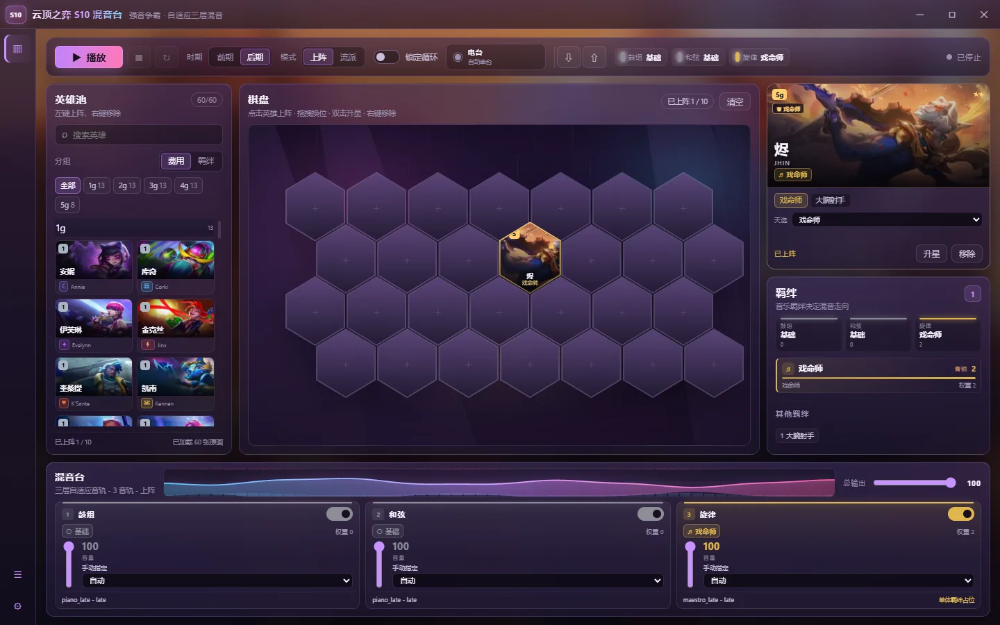
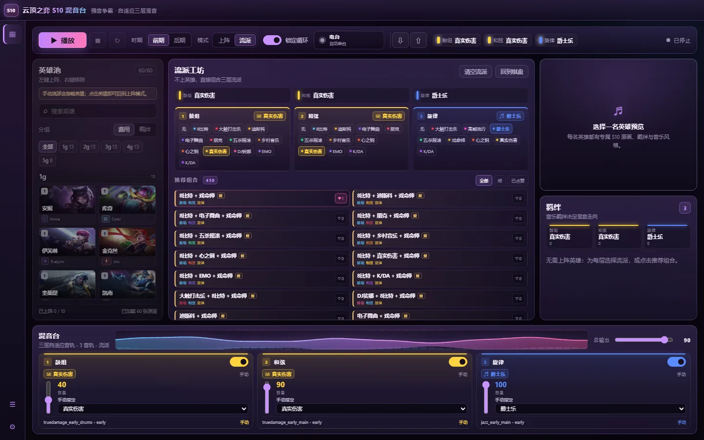
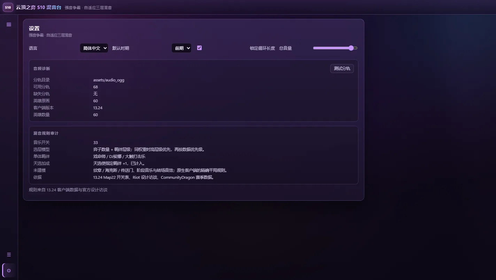

# Set 10 Mixing Desk

[简体中文](README.md) | **English**

A desktop recreation of the Teamfight Tactics **Set 10 (Remix Rumble / patch
13.24)** adaptive soundtrack, built as a Tauri 2 + Vue 3 app. Place champions on
the board and the app selects the drums, chords and top layers the same way the
game does - or ignore champions entirely and compose the mix by hand.



## What it does

- **One desk page**: champion pool, 4x7 hex board, hero spotlight, traits and the
  three-channel mixing desk are visible together.
- **Radio**: builds a themed board, starts playback and holds one style combo
  for one full song (about 2:45-3:22, depending on style and era) before rotating
  combos and eras. Skip with one button. The heart likes the combo on air; the
  broken heart bans it so the radio never picks it again, and the Settings page
  lists every banned combo for restoring.
- **Style Lab**: no champions required. Generates all **458 usable 1-3 style
  combinations**, with per-style and per-combo likes that reorder the
  recommendations. Jhin combinations start at the top.
- **Headliner**: mark a unit as Headliner and give one of its traits +1, matching
  the set mechanic that pushes breakpoints.
- **Lineup files**: export and import the board, stars, Headliner, era, mix mode
  and layer settings as JSON.
- **Localized**: English and Simplified Chinese champion, trait and style names,
  read from Riot's `zh_CN` set data.
- **Live visuals**: the selected champion becomes the blurred global wallpaper,
  panels stay translucent over it, and the mixer header carries a real-time
  waveform/spectrum analyser.
- **Set 10 art**: 60 in-game TFT champion banners for the UI and 60 square set
  splashes used only for the wallpaper.



## How the game's mix works

The soundtrack is three layers, each selected by its own Wwise switch:

```
Set_Switch_set10_<style>_<layer>      layer in { drums, chords, top }
```

The 13.24 `Map22.wad.client` switch table contains **33 names**. `none` is the
base track for a layer no style occupies.

| style id | trait | layers |
| --- | --- | --- |
| `8bit` | 8-bit | drums, chords |
| `classical` | Maestro (Jhin) | top |
| `country` | Country | drums, chords |
| `dj` | Mixmaster (Sona) | drums |
| `edm` | EDM | drums, chords |
| `emo` | Emo | drums, chords |
| `funk` | Disco | drums, chords |
| `hyperpop` | Hyperpop | top |
| `illbeats` | ILLBEATS | drums, top |
| `jazz` | Jazz | top |
| `kda` | K/DA | drums, chords, top |
| `none` | base | drums, chords, top |
| `pentakill` | Pentakill | drums, chords, top |
| `popband` | Heartsteel | drums, chords, top |
| `punkrock` | Punk | drums, chords |
| `truedamage` | True Damage | drums, chords, top |

Riot's design interview confirms that the mix follows **unit counts**, that the
breakpoint tier raises a style's share, and that a solo act such as Maestro (Jhin)
always takes one layer. The desk implements:

```
weight(style) = units(style) + tierIndex(style breakpoints, count)

for each layer:
  take the heaviest style that provides the layer
  equal weight -> higher breakpoint tier, then the data priority order
  no style -> none

solo acts (classical, dj, illbeats) hold a layer before the normal winners
Headliner: +1 to the chosen trait before tiers are calculated
```

The exact arithmetic and tie-break are an **evidence-backed reconstruction**, not
a byte-perfect copy of the native client. The confirmed and unmodelled parts are
listed in the app under **Settings -> Music rule audit**:



Not modelled: emblems/augments/portals that add traits or champions, Wwise phase
music and stingers, and the client's exact internal tie-break.

## Quick start

### Requirements

- Windows 10/11 with the WebView2 runtime (Tauri desktop build)
- [Bun](https://bun.sh/) for the frontend
- Rust stable for `tauri dev` / `tauri build`
- Python 3.14 with Pillow and NumPy only if you want to regenerate art/data

### Run

```powershell
bun install
bun run dev        # browser dev server: http://127.0.0.1:8787
bun run app:dev    # Tauri window (frameless, custom title bar)
bun run build      # vue-tsc --noEmit + production bundle
bun run app:build  # NSIS installer
```

The browser mode is useful for UI work. Tauri adds the native window, the asset
protocol and the Rust data/settings commands.

### Audio stems

The repository deliberately excludes the extracted audio (`assets/audio_ogg`
and `assets/audio` are git-ignored; the game audio is not redistributable).
Without stems the desk still runs, but playback reports missing files.

Put the converted stems in `assets/audio_ogg`:

```
assets/audio_ogg/
  kda_late_drums.ogg
  kda_late_main.ogg
  ...
  durations.json
```

`tools/convert_stems.py` converts the AAC rips in `assets/audio` into the OGG
files, and `tools/build_dataset.py` rebuilds the JSON data. The **Settings ->
Audio diagnostics** card shows the resolved folder, the number of stems found,
missing requirements and a 3-stem decode test.

### Hero art and stage

The 120 hero images and the stage backdrop are committed, so a fresh clone has
the full UI immediately. Regenerate them with:

```powershell
python tools/fetch_hero_art.py     # banner/ + wallpaper/ + credits.json
python tools/make_board_art.py     # stage.webp + grain.png
```

Both scripts are idempotent; `--force` on the first re-downloads every portrait.
Restart Vite after regenerating art because `import.meta.glob` is evaluated once.

## Using the desk

1. Pick a champion in the pool, or switch the pool to **Trait** grouping.
2. Left-click to deploy, right-click to remove, drag a hex to move or swap,
   double-click to star up.
3. Select a unit to open its spotlight: upgrade, remove, or set a Headliner.
4. Press **Play**, then mix live with the layer switches, faders and overrides.
5. Switch **Mode** to **Style Lab** to compose without champions; the layer racks,
   filters and hearts are all there.
6. Use the two arrows in the transport to export/import a lineup JSON.
7. **Radio** auto-builds boards; `Next station` skips, the heart likes the combo
   on air, the broken heart bans it for good, and stopping restores your previous
   board and settings. Banned combos are managed under **Settings > Radio
   dislikes**.

Lineup files are portable JSON:

```json
{
  "format": "set10-desk-lineup",
  "version": 1,
  "set": 10,
  "patch": "13.24",
  "era": "late",
  "mixMode": "board",
  "units": [
    { "apiName": "TFT10_Jhin", "star": 2, "slot": 10, "headliner": "Maestro" }
  ],
  "layers": {
    "drums": { "enabled": true, "volume": 1, "override": null },
    "chords": { "enabled": true, "volume": 1, "override": null },
    "top": { "enabled": true, "volume": 1, "override": null }
  }
}
```

## Architecture

```
Vue 3 + TypeScript (Vite)
  ChampionPool / BoardStage / StyleLab / HeroSpotlight / TraitsPanel
  MixerPanel / Waveform / TransportBar / GlobalWallpaper
        |
  src/stores/desk.ts  (board, plan, radio, lineup, transport)
  src/stores/likes.ts (persisted likes and radio bans)
        |
  src/core/  data.ts  rules.ts  combos.ts  audio.ts  art.ts
        |
  Tauri 2 / Rust
    asset_root, scan_stems, load_data, load_settings,
    save_settings, log_event
```

Key implementation notes:

- `src/core/rules.ts` computes style weights, solo-act spotlighting and the
  three-layer plan.
- `src/core/combos.ts` generates every usable 1-3 style group with a perfect
  style-to-distinct-layer matching, so every style in a combo contributes.
- `src/core/audio.ts` uses one Web Audio voice per stem file, ramps gains, keeps
  a shared loop region and exposes the master analyser.
- `src/stores/desk.ts` owns board editing, manual mode, the audio-position driven
  radio rotation and lineup import/export.
- Packaged builds read `data/` and `assets/audio_ogg/` through Rust commands and
  the Tauri asset protocol; the hero art is bundled by Vite.

### Rust commands

| command | purpose |
| --- | --- |
| `asset_root` | resolved stem folder |
| `scan_stems` | list OGG stems, durations, missing requirements |
| `load_data` | read the JSON datasets from the repo/resource folder |
| `load_settings` / `save_settings` | JSON settings in the app config dir |
| `log_event` | mirror mixer diagnostics to stdout |

## Project layout

```
data/set10_units.json        60 units: cost, traits, style, art, nameZh
data/music_rules.json        styles, layers, thresholds, stems, zh labels
src/core/rules.ts            weights, solo acts, layer assignment
src/core/combos.ts           458 usable style combinations
src/core/audio.ts            Web Audio mixer + analyser
src/core/data.ts             data loading, Tauri commands, stem URLs
src/core/art.ts              banner / wallpaper / stage lookup
src/stores/desk.ts           reactive desk, radio, lineups
src/stores/likes.ts          persisted likes and radio bans
src/components/              pool, board, spotlight, traits, mixer, StyleLab,
                             PoolCard, Waveform, GlobalWallpaper
src/assets/heroes/banner/    60 TFT champion banners
src/assets/heroes/wallpaper/ 60 square set splashes
src/assets/board/            generated stage and grain
src/assets/screenshots/      README screenshots
src/i18n/                    English + Simplified Chinese messages
src-tauri/                   Rust backend and Tauri config
assets/audio_ogg/            converted stems (git ignored)
tools/                       extraction, conversion, dataset and art scripts
.agents/skills/              reusable pipeline know-how
tmp/                         scratch space (never committed)
```

## Regenerating data

```powershell
curl.exe -k -o tmp/tftdata/en_us.json https://raw.communitydragon.org/13.24/cdragon/tft/en_us.json
curl.exe -k -o tmp/tftdata/zh_cn.json  https://raw.communitydragon.org/13.24/cdragon/tft/zh_cn.json
python tools/build_dataset.py
```

The script writes `nameZh`, `traitNamesZh` and `styleNamesZh` with `\u` escapes,
so the repository stays ASCII while the UI renders Chinese.

## Troubleshooting

**Port 8787 already in use** - `bun run app:dev` uses
`tools/dev-server-guard.mjs` and reuses an existing Vite server. Vite binds
`127.0.0.1`; use that instead of `localhost` (which may resolve to `::1`).

**No sound** - open Settings -> Audio diagnostics. The stem folder must contain
the OGG files and `durations.json`. Browser mode serves them from Vite; packaged
builds resolve `assets/audio_ogg` through `asset_root` and the asset protocol.

**Changes not showing in the browser** - stop and restart `bun run dev` if a Vue
component's transformed module looks stale; Vite occasionally keeps an old
transform for a single file during rapid edits.

**Drag does not work in the Tauri window** - keep
`app.windows[0].dragDropEnabled` set to `false`; otherwise WebView2's file-drop
handler can swallow HTML5 drag events.

**Packaged app cannot find data** - `load_data` reads the bundled `data`
resource. Check `src-tauri/tauri.conf.json -> bundle.resources` includes both
`../data` and `../assets/audio_ogg`.

## Provenance and credits

- Audio: extracted from the Set 10 build and community rips; the OGG conversion
  and stem manifest live in `tools/`. Audio files are not committed.
- Art: TFT set 10 champion banners/splashes from CommunityDragon's patch 13.24
  game assets; `src/assets/heroes/credits.json` lists every source URL.
- Rules: the 13.24 `Map22.wad.client` switch/state table, CommunityDragon set
  data, and Riot's Remix Rumble design interview.
- This is a fan project. Teamfight Tactics and its assets belong to Riot Games;
  it is not affiliated with or endorsed by Riot.

Reusable research and build notes live in `.agents/skills/`:
`tft-set10-music-system`, `tft-champion-portraits`, `lol-wad-extraction`,
`riot-old-patch-extraction`, `tauri-vue-mixing-desk` and
`browser-cdp-smoke-test`.

## License

The source code in this repository is licensed under the **GNU General Public
License, version 3 only (GPL-3.0-only)**. The full text is in
[LICENSE](LICENSE).

Teamfight Tactics, League of Legends and their game assets, audio, names and
imagery belong to Riot Games and are **not** covered by the GPL. They are
included or downloaded here for a non-commercial fan project; see
[Provenance and credits](#provenance-and-credits) for sources and attribution.
If you redistribute a build, keep the GPL notice for the code and respect Riot's
asset rights separately.

## Known limitations

- The weight formula and tie-break are reconstructed; the in-game selection code
  is native and not shipped as a readable rule table.
- Likes and radio bans are stored locally (no account or server); there is no global like count.
- Emblems, augments, portals, music phases and stingers are out of scope.
- The app is Windows-first (Tauri/WebView2); the web dev server also runs on the
  other desktop platforms.
